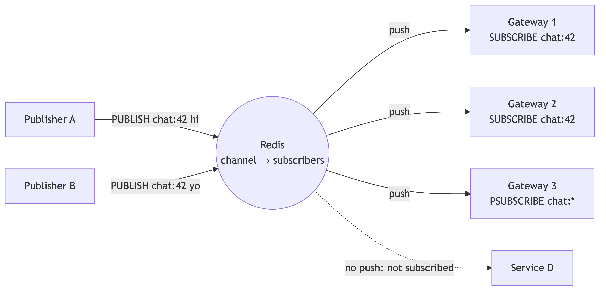
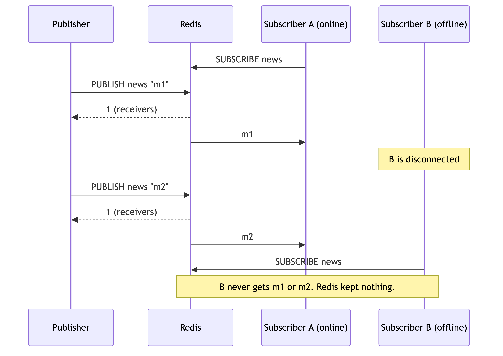

# Redis Pub/Sub

---

**Pub/Sub** lets a client send a message to a **channel**. Redis pushes the message to every client that subscribes to that channel at that time. Redis does not store the message. Read [Redis & Memcached](./redis-and-memcached.md) first.

## 1. How it works

- A **publisher** sends `PUBLISH channel message`. It does not know who listens.
- A **subscriber** sends `SUBSCRIBE channel`. Its connection then enters **subscribe mode**. It can only receive messages and manage subscriptions.
- Redis keeps a map of **channel → subscribed clients** in memory. No message is saved.
- `PUBLISH` returns the **number of receivers**. `0` means nobody got the message.
- Publishers and subscribers do not know each other. This is **loose coupling**.

## 2. Commands

| Command | Purpose |
|---|---|
| `PUBLISH ch msg` | Send `msg` to channel `ch`. Returns the receiver count. |
| `SUBSCRIBE ch [ch...]` | Listen to exact channels. |
| `PSUBSCRIBE pattern` | Listen to channels that match a glob, for example `chat:*`. |
| `UNSUBSCRIBE` / `PUNSUBSCRIBE` | Stop listening. |
| `PUBSUB CHANNELS` / `NUMSUB ch` | Inspect active channels and subscriber counts. |
| `SPUBLISH` / `SSUBSCRIBE` (Redis 7+) | **Sharded** pub/sub. See section 5. |

## 3. Delivery guarantee: at most once

Pub/Sub is **fire and forget**.

| Case | Result |
|---|---|
| Subscriber is offline | It **misses** the message. There is no replay. |
| Subscriber is slow | Redis buffers the output. If the buffer passes `client-output-buffer-limit pubsub`, Redis **closes** the connection. |
| Redis restarts | All subscriptions are lost. Clients must subscribe again. |
| Delivery check | No ack. No retry. No consumer group. |
| Many subscribers on one channel | **Each** gets a copy (fan-out). Subscribers do not share work. |

## 4. Pub/Sub vs Streams vs Kafka

| | **Pub/Sub** | **Redis Streams** | **Kafka** |
|---|---|---|---|
| Stores messages | No | Yes (log in RAM, optional disk) | Yes (disk log) |
| Offline consumer | Misses messages | Reads later from its last ID | Reads later from its offset |
| Delivery | At most once | At least once (with ack) | At least once |
| Consumer groups | No | Yes | Yes |
| Latency | Lowest | Low | Higher |
| Use when | Live signal, loss is fine | Small reliable queue | Large, durable event log |

**Rule of thumb:** if a lost message is a bug, do not use Pub/Sub alone. Save the data first (database, Stream or Kafka), then publish a signal.

## 5. Pub/Sub in Redis Cluster

- With classic `PUBLISH`, a node **broadcasts** the message to **all** nodes on the cluster bus. Cost grows with node count.
- **Sharded Pub/Sub** (Redis 7+) maps a channel to a **hash slot**, like a key. Only the nodes of that shard handle it. Use `SPUBLISH` and `SSUBSCRIBE`.
- Subscribers must connect to a node of the shard that owns the channel slot.

## 6. Use cases

| Use case | How |
|---|---|
| **WebSocket backplane** | Each gateway subscribes to its own channel. A service publishes to the gateway that holds the user's socket. See [WebSockets](../04-apis/websockets.md). |
| **Cache invalidation** | Publish `invalidate:user:42`. All app servers drop their local copy. |
| **Live feed, presence, typing** | Short-lived signals. Loss is fine. |
| **Config reload** | Tell all instances to refresh. |
| **Not suited** | Jobs, payments, orders. Use a queue, a Stream or Kafka. |

## 7. One-Paragraph Summary (for quick revision)

**Redis Pub/Sub** pushes each message on a **channel** to all clients that subscribe at that moment. `PUBLISH` returns the receiver count, `SUBSCRIBE` and `PSUBSCRIBE` (patterns) listen, and the subscriber connection stays in subscribe mode. It is **fire and forget**: **at-most-once**, no storage, no replay, no ack and no consumer groups. An offline subscriber misses messages, a slow one is disconnected when its buffer is full, and a Redis restart drops all subscriptions. In Redis Cluster, classic `PUBLISH` goes to all nodes, so use **sharded Pub/Sub** (`SPUBLISH`, Redis 7+) to scale. Use it for **WebSocket backplanes, cache invalidation, presence and live feeds**. For reliable delivery, use **Redis Streams** or **Kafka**, or save the data first and publish only a signal.
